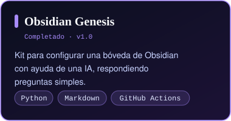
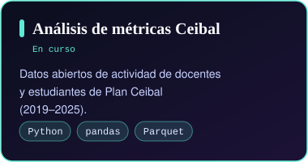
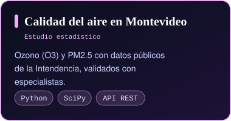

  

  
  
  
  

---

### 🧭 Sobre mí

Historiador y analista de datos. Trabajo donde se cruzan **la historia, la educación y la ciencia de datos**: leo fuentes, limpio datos y verifico cifras antes de publicarlas. Uso la IA de forma ética y transparente: en mis repositorios queda registrado qué asistente intervino y qué se revisó.

- 🎓 Licenciado en Historia (UdelaR) · estudio el Profesorado de Historia en el IPA
- 🔬 Coordino el **Proyecto METIS**: ciencia de datos ética, IA explicable y analíticas de aprendizaje en educación
- 🤝 Colaboro como voluntario con **Data Uruguay** en la apertura de datos de la Intendencia de Montevideo
- 📄 Autor de *«La programación de la historia: ciencia de datos para el análisis de fuentes históricas»*, *Claves. Revista de Historia* (2026)
- 🚀 Postulado a la Maestría en Ciencia de Datos y Aprendizaje Automático en la Universidad de la República -pendiente de aceptación-

### 🛰️ Proyectos

  
  
  

### 🧰 Herramientas

  
  
  
  
  
  
  
  

### 🌐 In English

Historian and data analyst from Montevideo, Uruguay, working where history, education and data science meet. Coordinator of the METIS Project (ethical data science and explainable AI in education), volunteer at Data Uruguay, and author of Obsidian Genesis. Enrrolled in a MCs in Data Science and Machine Learning at Universidad de la República.

«Leer las fuentes, limpiar los datos, verificar las cifras.»

